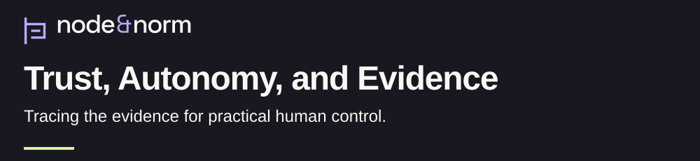
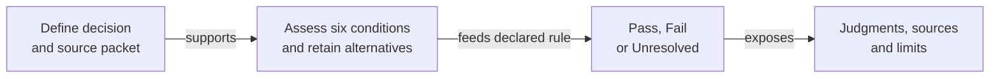

<h1>
<picture>
  <source media="(max-width: 600px)" srcset="assets/research/v1/tae-banner-mobile-dark.svg">
  
</picture>
</h1>

What evidence shows that a person could understand a consequential decision, intervene and affect what happened? TAE reconstructs those conditions from records of three historical cases. [Research question and contribution](docs/research-summary.md).

[Policy reader: understand in 90 seconds](#research-in-90-seconds) · [Reviewer: inspect the current paper](docs/current-review.md) · [Engineer: run the checks](docs/reference-verification.md)

<a href="docs/research-phase-closeout-2026-10-16.md"><picture><source media="(prefers-color-scheme: dark)" srcset="assets/research/v1/badges/tae-status-dark.svg"></picture></a>
<a href="https://github.com/node-and-norm/trust-autonomy-evidence/releases/tag/v0.18.0"><picture><source media="(prefers-color-scheme: dark)" srcset="assets/research/v1/badges/tae-version-dark.svg"></picture></a>
<a href="LICENSE"><picture><source media="(prefers-color-scheme: dark)" srcset="assets/research/v1/badges/tae-license-dark.svg"></picture></a>
<a href="https://doi.org/10.5281/zenodo.23852566"><picture><source media="(prefers-color-scheme: dark)" srcset="assets/research/v1/badges/tae-deposit-20261101.svg"></picture></a>

<a href="paper/revisions/2026-11-08/README.md"></a>

## Start with the latest revision

[November 8 main preprint](paper/revisions/2026-11-08/preprint_two_column.pdf) · [Companion supplement](paper/revisions/2026-11-08/preprint_supplement.pdf) · [Plain-English historical study book](notebooks/historical-study/00_READ_FIRST.ipynb) · [Revision and submission status](paper/revisions/2026-11-08/README.md)

The November 8 revision is available in this repository; the earlier November 1 edition is deposited on Zenodo. The main PDF is the verified arXiv-processed submission copy with its genuine side watermark; the supplement remains a local compile. The watermark is a submission mark, not a public article identifier or acceptance. The November 1 DOI badge above identifies the older deposited edition, not this revision. This editorial update does not establish new validation.

## Choose a notebook

[Study map](TAE_STUDY_MAP.ipynb) → [Read first](notebooks/historical-study/00_READ_FIRST.ipynb) → [Complete case records](notebooks/historical-study/01_COMPLETE_CASE_RECORDS.ipynb) → [ZG710 worked example](notebooks/historical-study/02_ZG710_WORKED_EXAMPLE.ipynb) → [Related methods](notebooks/historical-study/03_RELATED_METHODS_IN_PLAIN_ENGLISH.ipynb). No code execution is needed.

The separately delivered Jev exact-record notebook book is not yet included here. Its underlying [experiment records](docs/jev-experiments.md) are available. These TAE notebooks are separate from the revocation study.

Older paper folders retain their historical “current” or “latest” wording. For today’s reading route, use the links above and the [current review guide](docs/current-review.md).

## At a glance

| | Current account |
| :--- | :--- |
| Purpose | Trace evidence for practical human control in a defined decision. [Method](protocols/practical-human-control-test.md) |
| Status | Methods phase closed on October 16, 2026. Independent validation remains open. [Closeout](docs/research-phase-closeout-2026-10-16.md) |
| Evidence type | Three selected historical cases, synthetic test cases and separately recorded AI experiments. [Evidence register](RESEARCH_STATUS.md) |
| Version | Version: 0.18.0, released October 16, 2026. Current paper: November 8 editorial revision (21-page main + 15-page supplement). [Version guide](docs/current-review.md#versions-and-publication) |
| License | [Apache-2.0](LICENSE), with [existing attribution](NOTICE). |
| Cite | [November 1 deposited edition: 10.5281/zenodo.23852566](https://doi.org/10.5281/zenodo.23852566) · [citation metadata](CITATION.cff) |

The approved additional reassessment leaves all three cases **Unresolved**, conditional on the retained judgments. Independent reliability, contemporary AI transfer and institutional effectiveness remain unestablished. [Results and limits](RESEARCH_STATUS.md#approved-reassessment-and-preserved-results).

## Research in 90 seconds

An assigned reviewer needs an opportunity to act. TAE asks what the records establish about that opportunity in a specific decision. Its six-condition method examines access to information, comprehension, authority, feasibility, exercised judgment and whether an intervention reached the action. [Protocol](protocols/practical-human-control-test.md).

The contribution is an inspectable reconstruction method. A reviewer can follow a judgment to its source, inspect its limits and see how a changed judgment affects the case finding. The demonstration covers the Oko warning, Tornado ZG710 and F/A-18C cases. [Contribution and case findings](docs/research-summary.md), [approved comparison](paper/revisions/2026-10-10/README.md#findings-and-approval-scope).

The method preserves missing or disputed evidence. A justified failure of any necessary condition produces **Fail**. All six supported conditions produce **Pass**. Other combinations produce **Unresolved**. An Unresolved finding leaves practical control unestablished in either direction. [Aggregation rule and retained alternatives](RESEARCH_STATUS.md#approved-reassessment-and-preserved-results).

## Method in brief



The diagram summarizes the [case-reconstruction protocol](protocols/public-case-reconstruction-protocol.md), [control conditions](protocols/practical-human-control-test.md) and [approved reassessment](paper/revisions/2026-10-10/README.md). The text sequence is: define the decision, assemble records, assess conditions, retain alternatives, calculate the finding and expose its reasons. Independent assessment of those judgments remains open. [Known limits](LIMITATIONS.md).

## Evidence and known limits

| Material | What is available | What remains open |
| :--- | :--- | :--- |
| Historical cases | Three selected public-source reconstructions and preserved earlier findings. [Case comparison](paper/revisions/2026-10-10/README.md#findings-and-approval-scope) | One researcher's assessment. Independent reliability and broader transfer remain unestablished. [Limits](docs/research-summary.md#limits-and-next-evidence) |
| Conditional reassessment | All 64 retained joint assignments yield 0 Pass, 0 Fail and 3 Unresolved. [Result](RESEARCH_STATUS.md#approved-reassessment-and-preserved-results) | Computational agreement leaves the validity of the retained judgments unresolved. [Approval scope](paper/revisions/2026-10-10/README.md#findings-and-approval-scope) |
| Synthetic checks | Invented test cases, expected decisions and deliberate corruptions test declared software behavior. [Test protocol](protocols/solo-validation-protocol.md) | These checks establish behavior on the supplied inputs. Field effectiveness requires separate evidence. [Limits](LIMITATIONS.md) |
| AI experiments | Saved Jev model outputs, review-assistance results and collaborative author-review records. [Experiment guide](docs/jev-experiments.md) | All 1,079 original adjudications remain unresolved. The timed human comparison was omitted. Human benefits remain unmeasured. [Status](RESEARCH_STATUS.md#preserved-jev-results) |
| Source review | Dated personal reading records preserve passages read, access routes and proposed corrections. [Review log](docs/personal-source-review-2026-11-03.md) | Selected reading and later-draft proposals have their recorded scope. Manuscript adoption requires a separate decision. [Disposition record](docs/personal-source-review-2026-11-03.md) |

The methods phase closed within its declared scope. Incomplete literature coverage, source-access limits and absent independent validation remain recorded. [Phase closeout](docs/research-phase-closeout-2026-10-16.md), [threats to validity](LIMITATIONS.md).

## Reproduce the checks

Use Python 3.12 and the repository's pinned dependencies. The [verification guide](docs/reference-verification.md) gives exact commands, expected outputs and write effects. It separates byte-preservation checks, calculation checks and historical replay. The aggregate validators run in a disposable copy because one nested builder writes tracked files. [Existing validator](scripts/validate_repository.py), [nested builder](scripts/build_forward_citation_author_screening_v0_13_0.py).

A successful check establishes its declared software or file-identity condition. Human judgment and empirical validity retain their separate review requirements. [Reproducibility limits](docs/REPRODUCIBILITY.md).

## AI assistance and human review

Codex contributed to research, manuscript preparation and code. Jev supplied outputs in separate recorded experiments. The paper's disclosure identifies these roles and unavailable model details. [Current disclosure: AI assistance and review limits](paper/revisions/2026-11-08/preprint_two_column.pdf) · [Preserved November 1 disclosure](paper/revisions/2026-11-01/main.tex#L1466-L1480).

Author authorization, selected personal reading and independent verification have different scopes. The records identify what the author reviewed and which checks remain incomplete. [Review attestation](evidence/human-review-attestation-v0.14.0.json), [personal source review](docs/personal-source-review-2026-11-03.md), [program disclosure](https://nodeandnorm.org/about/research-integrity/#ai-use).

## Cite the paper

The following entry renders the existing preferred citation in [CITATION.cff](CITATION.cff). The November paper and repository v0.18.0 retain their separate identities. [Publication receipt](docs/zenodo-publication-2026-11-01.md), [repository release](https://github.com/node-and-norm/trust-autonomy-evidence/releases/tag/v0.18.0).

```bibtex
@misc{banasihan2026practicalcontrol,
  author = {Banasihan, Mark Julius},
  title = {From Formal Authority to Practical Human Control: A traceable method for reconstructing human control in automated decisions},
  year = {2026},
  month = nov,
  doi = {10.5281/zenodo.23852566},
  url = {https://doi.org/10.5281/zenodo.23852566},
  note = {Preprint. Editorial revision, November 1, 2026}
}
```

<details>
<summary>Earlier editions, technical history and the complete prior entry</summary>

The [complete prior README](README-2026-11-03.md) preserves the entry text at [audit commit 78e672e](https://github.com/node-and-norm/trust-autonomy-evidence/tree/78e672ec6ab416c5e55525f2d40322727f7f645d). It retains the artifact catalog, figures, release history, commands and earlier citations. Use the [current review guide](docs/current-review.md) for the November paper and its later publication receipt.

- [Current research status](RESEARCH_STATUS.md)
- [Material claims and evidence](CLAIMS.md)
- [Full reproducibility guide](docs/REPRODUCIBILITY.md)
- [Historical release notes](release/)
- [Contribution policy](CONTRIBUTING.md)

</details>

Research by [Mark Julius Banasihan](https://orcid.org/0009-0001-8121-2878). [Node & Norm](https://nodeandnorm.org/) · [Research integrity](https://nodeandnorm.org/about/research-integrity/).

